# VidyaVision Voice AI Call Center Platform
## Official Client Onboarding & Comprehensive User Guide

> **Version:** 2.0 Enterprise  
> **Brand:** VidyaVision — *Every Student's Vision*  
> **Target Audience:** College Directors, Admission Heads, IT Administrators & Counseling Teams

---

## Table of Contents
- [1. Platform Overview & Architecture](#1-platform-overview--architecture)
- [2. Sign In & Session Security](#2-sign-in--session-security)
- [Part 1: General Platform User Manual](#part-1-general-platform-user-manual)
  - [3. Colleges Management & AI Bot Configuration](#3-colleges-management--ai-bot-configuration)
  - [4. Team & Granular Permissions Management (RBAC)](#4-team--granular-permissions-management-rbac)
  - [5. Call Dashboard & Real-Time Intelligence](#5-call-dashboard--real-time-intelligence)
  - [6. Recent Calls, Audio Recordings & Transcripts](#6-recent-calls-audio-recordings--transcripts)
- [Part 2: End-to-End Voice AI Calling Process (10 Steps)](#part-2-end-to-end-voice-ai-calling-process-10-steps)
  - [Step 1: Inputting & Uploading Recipient Contacts](#step-1-inputting--uploading-recipient-contacts)
  - [Step 2: Choosing / Adding from Existing Campaigns](#step-2-choosing--adding-from-existing-campaigns)
  - [Step 3: Campaign Configuration & Dynamic Bot Routing](#step-3-campaign-configuration--dynamic-bot-routing)
  - [Step 4: Call Buffer Delay & Contact Range Selector](#step-4-call-buffer-delay--contact-range-selector)
  - [Step 5: Stage Contacts & Staged Calling Queue Review](#step-5-stage-contacts--staged-calling-queue-review)
  - [Step 6: Campaign Schedule, Cutoff Limits & Call Transfer](#step-6-campaign-schedule-cutoff-limits--call-transfer)
  - [Step 7: Start AI Calling Campaign & Live Controls](#step-7-start-ai-calling-campaign--live-controls)
  - [Step 8: Managing Paused Campaigns in Call Dialer](#step-8-managing-paused-campaigns-in-call-dialer)
  - [Step 9: Completed Campaigns & Analytics in Dashboard](#step-9-completed-campaigns--analytics-in-dashboard)
  - [Step 10: Recent Calls Intelligence, Audio Playback & WhatsApp](#step-10-recent-calls-intelligence-audio-playback--whatsapp)
- [7. Spreadsheet Formatting & Lead Preparation Guide](#7-spreadsheet-formatting--lead-preparation-guide)
- [8. Troubleshooting & Frequently Asked Questions (FAQ)](#8-troubleshooting--frequently-asked-questions-faq)

---

## 1. Platform Overview & Architecture

**VidyaVision Voice AI** is an enterprise-grade automated telephony and student admission intelligence platform. It autonomously dials prospective student leads, conducts intelligent, human-like voice conversations in multiple languages (English, Hindi, Telugu), identifies student course interests, and transfers high-intent inquiries live to admission counselors.

```
┌────────────────────────────────────────────────────────────────────────┐
│                        VIDYAVISION VOICE AI FLOW                       │
└────────────────────────────────────────────────────────────────────────┘
          │
          ├── 1. Counselor uploads Excel/CSV lead spreadsheet (.xlsx/.csv)
          │
          ├── 2. Sequential Calling Engine dials students automatically
          │
          ├── 3. Conversational AI speaks to the student & assesses interest
          │       ├─ If student requests counselor ──> Live Call Transfer to mobile
          │       └─ If call finishes ───────────────> AI extracts profile & notes
          │
          └── 4. Results sync in real-time to Dashboard, Google Sheets & DB
```

### Core Capabilities:
- **Autonomous Outbound Dialing:** High-throughput batch calling with customizable inter-call delays and quiet-hours compliance.
- **Natural Multi-turn Conversations:** Dynamic query handling for fee structures, eligibility criteria, hostel facilities, and application deadlines.
- **Live Counselor Call Transfer:** Seamless bridge forwarding to designated counselor phone numbers when a student requests to speak with an officer.
- **Granular Role-Based Access Control (RBAC):** Strict separation between Administrators and Counselors, with integrated **Data Leak Protection**.
- **Real-Time WebSocket Synchronization:** Live progress updates, immediate permission refreshes, and instant campaign tracking across all users without browser reloads.

---

## 2. Sign In & Session Security

### Accessing the Portal:
1. Open your designated web browser (Google Chrome, Microsoft Edge, or Mozilla Firefox).
2. Navigate to your portal address (e.g., `https://your-domain.com` or local network URL).
3. The official **VidyaVision** secure authentication portal will appear.

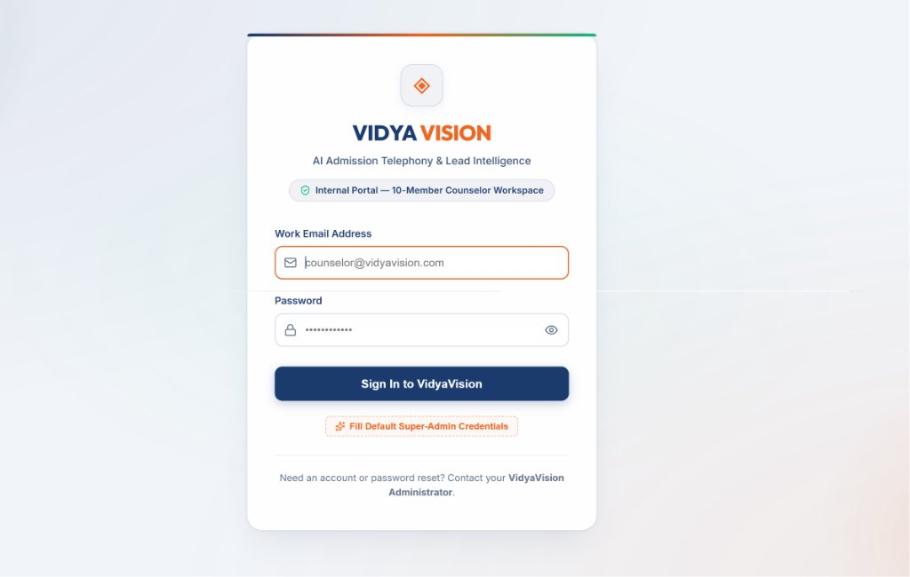
*Figure 1: Clean, secure counselor authentication screen with official VidyaVision branding.*

### User Roles at a Glance:
- **System Administrator:** Unrestricted control across team management, university configurations, dialing batches, and Excel data exports.
- **Admission Counselor:** Focused workspace for uploading lead lists, staging and executing call runs, reviewing recordings/transcripts, updating student follow-up notes, and receiving transferred calls.

### Security Best Practices:
- Passwords must be at least 6 characters in length.
- Sessions are protected via secure tokens.
- **Instant Logout:** Clicking **Logout** in the top navigation bar immediately terminates your active session and wipes in-memory draft queues.

---

# Part 1: General Platform User Manual

---

## 3. Colleges Management & AI Bot Configuration

VidyaVision allows multi-college management from a single interface. System Administrators and authorized staff can register colleges, configure program catalogs, link distinct AI telephony agents, and set default counselor transfer numbers.

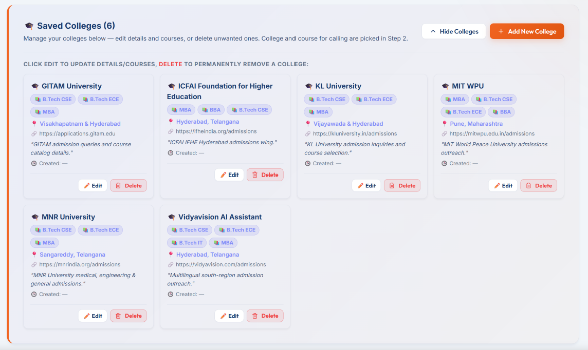
*Figure 2: Saved colleges catalog showing location, course offering tags, AI agent IDs, and "+ Add New College" button.*

### 3.1 Adding a New College:
1. In the header or the **Manage Colleges** modal, click **"+ Add New College"**.
2. Fill in the institutional profile:
   - **College / University Name:** Official registered name (e.g., *VidyaVision Institute of Technology*).
   - **Campus Location / City:** (e.g., *Hyderabad, Telangana*).
   - **Course Offerings:** Add programs as comma-separated tags or pill badges (e.g., *B.Tech, CSE, MBA, Data Science, AI & ML*).
   - **Primary AI Voice Agent ID:** Telephony bot ID configured in the voice engine (e.g., `270740` for UG or `270604` for PG).
   - **Default Counselor Transfer Number:** The direct 10-digit mobile number that live student calls bridge to when a student asks to speak with an advisor.
   - **Official Website & Prospectus URL:** Automatic URL dispatched to students via WhatsApp.
3. Click **"Save College"** to instantly update the platform database.

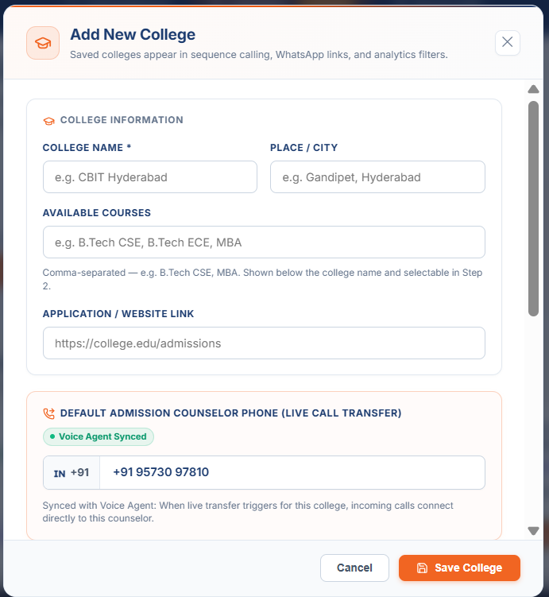
*Figure 3: Add / Edit College modal with course tags, bot agent ID, and live counselor transfer phone number.*

### 3.2 Editing or Deleting Colleges:
- Click the **Pencil (Edit)** icon on any college card to update programs, change counselor transfer numbers, or modify telephony bots.
- Click the **Trash (Delete)** icon to remove an obsolete institution.

---

## 4. Team & Granular Permissions Management (RBAC)

Administrators have access to the **Team Management** portal via the System Admin pill badge in the navigation header.

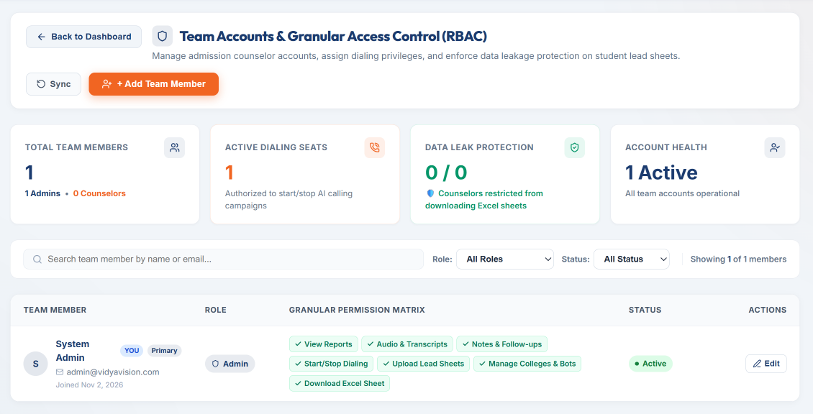
*Figure 4: Role-based access control console displaying active dialing seats, Data Leak Protection status, and granular permission badges.*

### 4.1 The 7 Granular Permission Flags:
Admins can toggle permissions individually for each team member:

| Permission Flag | Description | Recommended for Counselors |
| :--- | :--- | :---: |
| **View Reports** | Access high-level analytics, dashboards, and charts. | **YES** |
| **Audio & Transcripts** | Listen to student call recordings and read dialog transcripts. | **YES** |
| **Notes & Follow-ups** | Save counselor feedback, set callback dates, and send WhatsApp. | **YES** |
| **Upload Lead Sheets** | Import student contact spreadsheets (`.xlsx`, `.csv`) into dialer. | **YES** |
| **Start/Stop Dialing** | Initiate live sequential AI calling campaigns and manage queues. | Optional (Senior) |
| **Manage Colleges & Bots** | Add/edit university profiles, agent IDs, and course catalogs. | **NO (Admin Only)** |
| **Download Excel Sheet** | Export student contact databases and duration sheets to Excel. | **NO (Data Leak Guard)** |

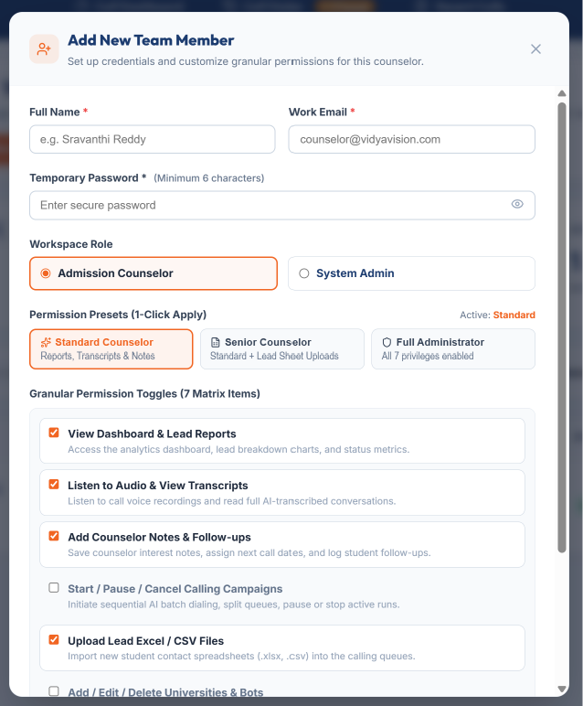
*Figure 5: Add / Edit User modal with role presets and custom 7-flag granular permission toggles.*

### 4.2 Adding a New Team Member:
1. Click **"+ Add Team Member"** in the Team Management console.
2. Enter the user's **Full Name**, **Email Address**, and temporary **Password**.
3. Select a role preset (*Standard Counselor*, *Senior Counselor*, or *System Administrator*), or customize permissions individually using the 7 checkboxes.
4. Click **"Create User"**.

### 4.3 Real-Time Account Management:
- **Instant Suspension:** Toggling a counselor's status to **Suspended** terminates their session in real-time over WebSockets, immediately returning them to the login screen.
- **Live Permission Updates:** When an Admin edits a counselor's permissions, the counselor's browser updates instantaneously without requiring a page reload or re-login.

---

## 5. Call Dashboard & Real-Time Intelligence

The **Call Dashboard** provides real-time high-level intelligence and lead outcome metrics across all university campaigns.

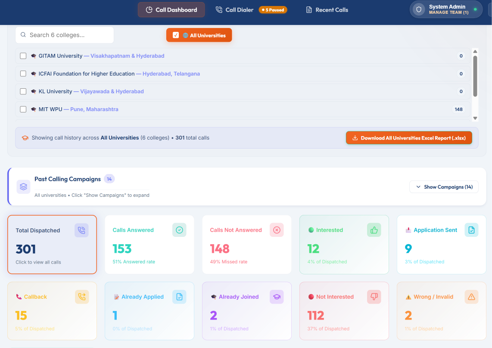
*Figure 6: Real-time call intelligence dashboard showing student intent breakdown, readiness signals, and university filters.*

### 5.1 Key Performance Metric Cards (KPIs):
At the top of the dashboard, five real-time summary cards reflect call performance:
1. **Total Student Calls:** Complete count of call dispatches initiated.
2. **Interested Students (Green):** Students who expressed positive admission intent or requested program details.
3. **Counselor Follow-up Required (Amber):** Students requesting callbacks, fee discussions, or live counselor interactions.
4. **Not Interested (Red):** Students who declined admission or chose another institution.
5. **Calls Not Answered (Rose):** Dispatches where the recipient did not answer, phone was switched off, or went to voicemail.

### 5.2 Granular Filter Bar:
Filter data dynamically by:
- **Date Range:** Today, Yesterday, Last 7 Days, Last 30 Days, or Custom Date Picker.
- **University Scope Dropdown:** Select a specific institution (e.g., *VidyaVision AI Assistant*, *MIT WPU*, *KL University*) or view aggregated metrics across **"All Universities"**.
- **Lead Status Pills:** Click any status category to narrow down the table instantaneously.

### 5.3 AI Student Profile & Readiness Signals:
The platform analyzes every conversation transcript to extract actionable student signals:
- **Immediate (2026):** Students seeking enrollment in the upcoming intake.
- **Counsellor Req:** Inquiries that explicitly requested a human advisor.
- **Transferred:** Calls that successfully bridged to a counselor's mobile.
- **No Scores Provided:** Students who need counseling regarding qualifying exams.
- **Grad Completed:** Students eligible for postgraduate admissions.

### 5.4 Excel Report Downloading & Data Leak Protection:
- **Authorized Users (Admins & Senior Staff):** Click the green **"Download Excel Report (.xlsx)"** button to export comprehensive student contact sheets, durations, recordings, and lead ratings.
- **Standard Counselors:** The button displays a locked indicator (`Download Excel Report (Restricted)`) to prevent bulk student data leakage outside the organization.

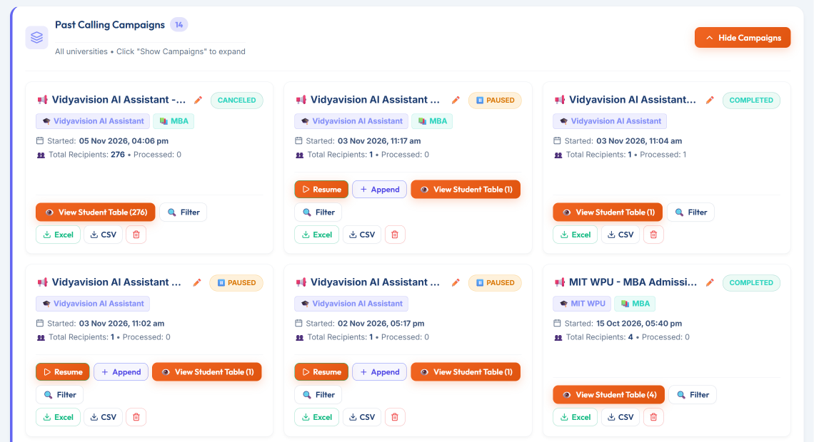
*Figure 7: Historical Calling Campaigns archive with lead records inspection and Excel/CSV download buttons.*

---

## 6. Recent Calls, Audio Recordings & Transcripts

The **Recent Calls** tab is your complete operational log of all dialed calls.

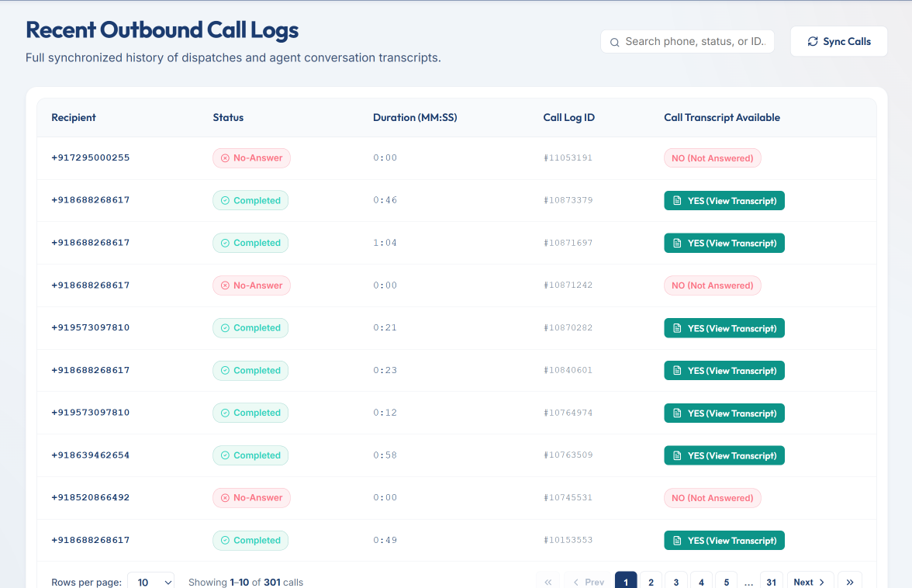
*Figure 8: Comprehensive call logs featuring AI lead outcome classifications, timestamps, durations, search, and action buttons.*

### 6.1 Call Detail Modal:
Clicking **Detail Report** on any call opens the comprehensive student inspection card:
1. **Multi-Channel Audio Player:** Listen to the complete call recording directly in the browser with play, pause, seek, and playback speed controls.
2. **Turn-by-Turn Conversation Transcript:** Read the verbatim dialog between the Voice AI and the student, complete with exact timestamps and caller intent badges.
3. **AI Summary:** A concise 2-sentence synopsis summarizing the student's background, eligibility questions, and preferences.

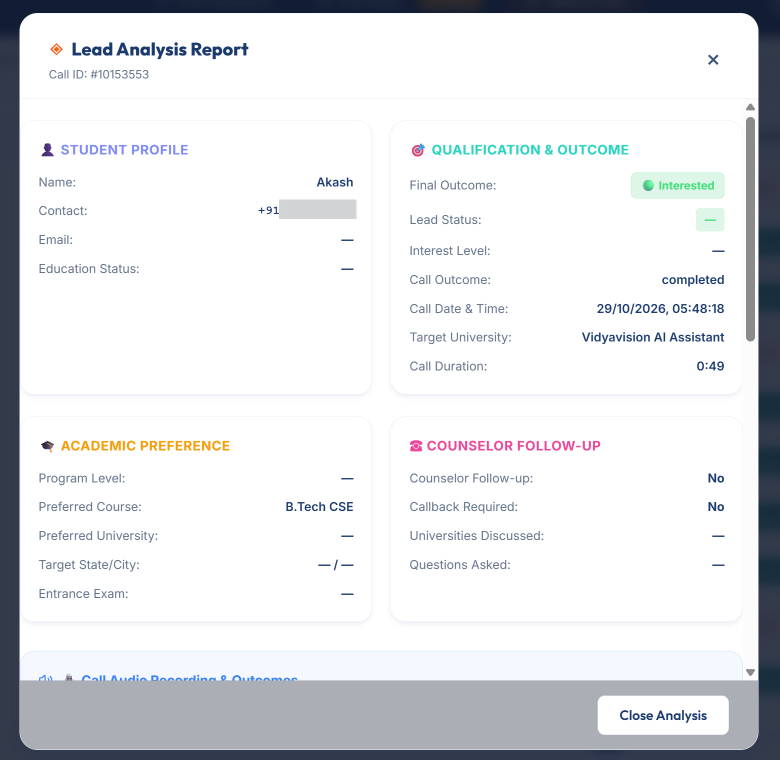
*Figure 9: Student call inspection modal showing embedded audio player, verbatim turn-by-turn dialogue, counselor notes, and WhatsApp prospectus dispatch.*

### 6.2 Counselor Follow-Up Actions:
Counselors can update student records directly inside the Detail Modal:
- **Update Interest Status:** Adjust the status to *Interested, Callback Requested, Follow-up Needed, Admission Confirmed*, or *Not Interested*.
- **Counselor Notes:** Record key student details (e.g., *"Student scored 88% in 12th; requested scholarship details via WhatsApp"*).
- **Next Follow-Up Date:** Schedule automated calendar reminders for callbacks.
- **1-Click WhatsApp Admission Brochure:** Click **"Send WhatsApp Info"** to automatically deliver official college prospectus links and application forms to the student's mobile number.

---

# Part 2: End-to-End Voice AI Calling Process (10 Steps)

The **Call Dialer** is the central command center for importing leads, configuring dynamic voice bot parameters, setting time limits, and orchestrating live sequential calling campaigns.

Follow this 10-step process for executing calls:

---

### Step 1: Inputting & Uploading Recipient Contacts
Under **1. Upload calling data / recipient list**, select one of four flexible input methods:

1. **Method A — Excel / CSV Spreadsheet Upload (Recommended for Batch Dialing):**
   - Click the **Excel / CSV Upload** tab.
   - Drag and drop your `.xlsx`, `.xls`, or `.csv` file into the upload dropzone (or click to browse).
   - **Intelligent Auto-Sanitizer:** The system automatically extracts 10-digit Indian mobile numbers, strips country codes (`+91`, `0`), extracts student names and courses, discards incomplete digits, and filters duplicates.
   - **Uploaded File Capsule:** Shows the file name, file size, extraction timestamp, and total valid contacts count.
   - **Appending / Merging Sheets:** Click **"+ Add Numbers from Excel"** to append more numbers to this batch without losing previous records, or click **"Replace File"** to start fresh.
   - **Recent Excel Uploads & Resume Calling:** One-click quick load of past uploaded spreadsheets with progress badges (e.g., `Resume from #201`).
   - Download the official sample format using the **"Download Sample CSV Template"** button.

2. **Method B — Single Number Input (On-Demand Ad-Hoc Calls):**
   - Click the **Single Number Input** tab.
   - Enter a 10-digit mobile number in the **Phone Number (Required) \*** field.
   - Enter the student's name in the **Recipient Name (Optional)** field. When provided, the AI bot personally greets the student by name (e.g. *"Hello Ramesh, I am calling from VidyaVision Admissions..."*).
   - Click **"+ Import Contact"** to load the student into the configuration staging batch.

3. **Method C — Bulk Paste Raw Text:**
   - Click the **Bulk Paste Text** tab.
   - Paste unstructured text containing phone numbers copied from WhatsApp groups, email inquiries, or CRM notes.
   - Supported formats: comma-separated (`9876543210, Ramesh Kumar`), tab-separated, or single numbers per line.
   - Click **"Process & Import Numbers"** to sanitize and load contacts.

4. **Method D — Choose / Add from Existing Campaigns (Lead Re-Targeting):**
   - Click the orange **"Choose from Existing Campaigns"** button.
   - A modal displays all historical campaigns along with university name, dates, total contacts, and status.
   - Click **"Inspect Contacts"** on any past campaign to view individual student rows and check outcome badges.
   - Select individual contacts with checkboxes, or click **"Load All into Step 2"** to re-target unreached students or re-dial a batch.

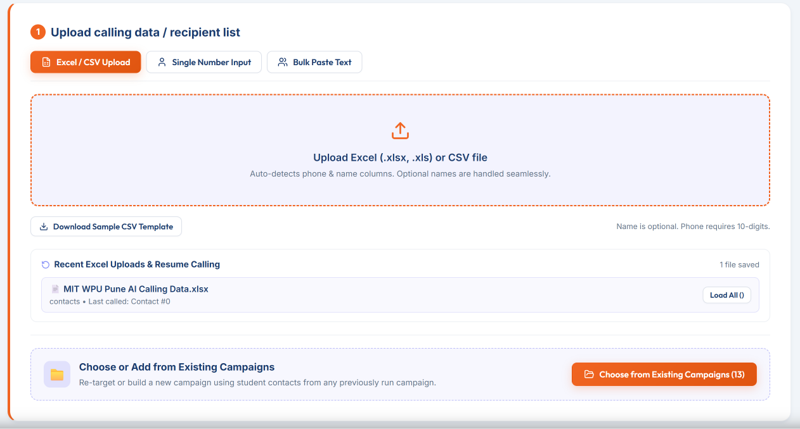
*Figure 10: Call Dialer Step 1 — Input Options (Excel/CSV Upload, Single Number, Bulk Paste, and Existing Campaigns)*

---

### Step 2: Choosing / Adding from Existing Campaigns
Clicking **"Choose from Existing Campaigns"** allows admission counselors to build new calling batches from historical campaigns:
- Inspect total contacts, completion statuses, and individual caller intents.
- Select specific uncalled or interested students.
- Click **"Load All into Step 2"** to stage leads into the dialer configuration pipeline.

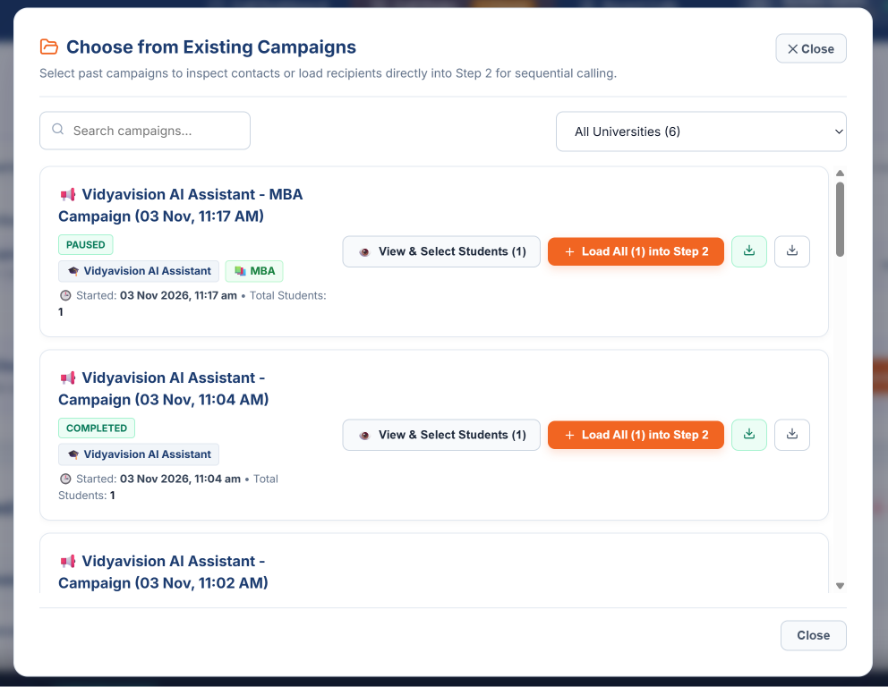
*Figure 11: Choose from Existing Campaigns Modal — Re-targeting and Sub-Batch Inspection*

---

### Step 3: Campaign Configuration & Dynamic Bot Routing
Once contacts are imported, the **"Configure Calling Settings"** panel activates automatically:

1. **Campaign Name (Optional):**
   - Enter a custom name for this campaign run (e.g., `KL University B.Tech Phase 1` or `Weekend MBA Outreach`).
   - *Auto-naming:* If left blank, the platform automatically generates a standardized tag from the selected college and current date (e.g., `MIT WPU - Admissions Campaign (05 Nov)`).
2. **Select Target University:**
   - Search and choose the institution from the **Select Target University** dropdown.
   - The selected university card expands to display location, official website link, languages spoken (e.g. *English, Hindi, Telugu*), and telephony agent ID.
3. **Select Course & Automated Voice Bot Routing:**
   - Choose a course from the college's offering dropdown (or select *General* if unassigned).
   - **Dynamic Bot Routing:**
     - Selecting an **Undergraduate program** (e.g. *B.Tech, BBA, BCA, B.Sc*) automatically assigns the **🤖 UG Admission Assistant (Bot #270740)**.
     - Selecting a **Postgraduate program** (e.g. *MBA, M.Tech, MCA*) automatically assigns the **🤖 PG Admission Assistant (Bot #270604)**.


*Figure 12: Step 2 Campaign Configuration — University Selector, Course Offerings, and Voice Bot Routing*

---

### Step 4: Call Buffer Delay & Contact Range Selector
Under **"3. Select Call Buffer Delay between calls"**:
- **Call Buffer Delay:** Choose the buffer cooldown period between sequential calls: **0s (Instant), 2s (Recommended Default), 3s, 5s, or 10s** to give counselors time to log notes.
- **Contact Range Selector:** For batches larger than 1 contact, specify **"From Contact #"** and **"To Contact #"** (e.g., dial from `#201` to `#500`).
- **Quick Preset Buttons:** Click **"All (1–N)"**, **"First 100"**, or **"Resume from #N"** based on previous progress.
- *Preserved Excel Row Tracking:* Even when dialing contacts 201 to 500, the dialer retains the original Excel row numbers (e.g. `Row 202`) for auditability.

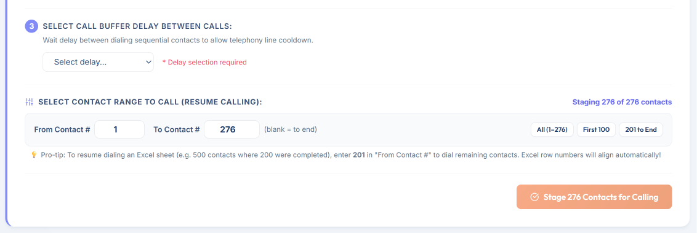
*Figure 13: Call Buffer Delay Cooldown & Contact Range Selector (Resume Calling)*

---

### Step 5: Stage Contacts & Staged Calling Queue Review
- Click **"Stage Contacts for Calling"** to push the configured batch into the active **Staged Calling Queue**.
- **Isolated User Workspace:** Staged queues are private to each counselor's login session. An Admin and Counselor working simultaneously will never see or overwrite each other's staged drafts.
- **Queue Table Review:**
  - Inspect `#`, Mobile Number, Student Name, Target University, Course, University ID badge (`#270740 UG` / `#270604 PG`), and Staged Status.
  - Delete individual contacts with the red trash button, or click **"Clear Queue"** to wipe the queue.

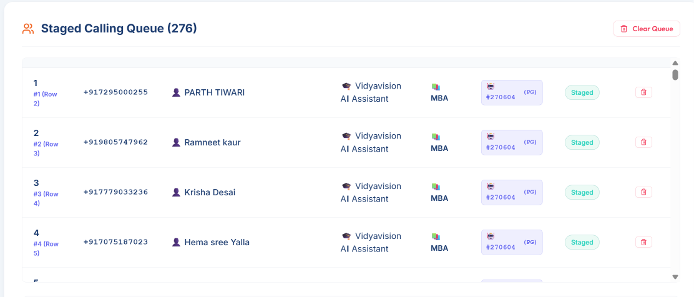
*Figure 14: Staged Calling Queue Table Review with Assigned Bot Personas*

---

### Step 6: Campaign Schedule, Cutoff Limits & Call Transfer
Click **"Configure"** on the **Campaign Schedule & Time Limits** bar:
1. **Start Timing:**
   - ⚡ **Start Immediately:** Dialing starts the second you click launch.
   - 📅 **Schedule for Later Time:** Pick a future date and time using the interactive picker, or click quick presets (*In 15 mins, In 30 mins, In 1 hour, Tomorrow 10:00 AM*).
2. **Stop Timing (Auto-Cutoff Compliance):**
   - ♾️ **No Limit:** Dials continuously until all queued contacts finish.
   - ⏳ **Duration Limit:** Stop automatically after a set duration (e.g. 30, 60, or 90 minutes).
   - 🛑 **Cutoff Time:** Set an exact stop time (e.g. 06:30 PM). Uncalled numbers are cleanly preserved as paused.
   - 🏢 **Business Window:** Restricts calls strictly to legal telecom business hours (**09:30 AM to 06:30 PM IST**).
3. **Counselor Live Call Transfer Configuration:**
   - Toggle **Enable Call Transfer** to allow the Voice AI to transfer high-intent students live to a human counselor.
   - Enter your active phone number in **Counselor Phone Number (Live Call Forwarding)** (e.g. `9876543210` with country code `+91`).
   - Click **"Sync to Voice Agent"** to update the telephony bridge. The green badge confirms: `✔ Connected to Voice Agent: +91 9876543210`.

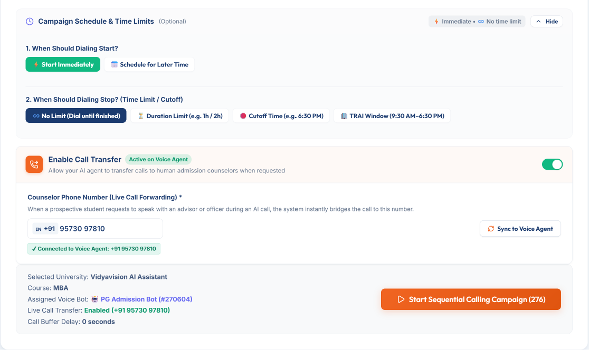
*Figure 15: Campaign Schedule, Auto-Cutoff Limits & Counselor Call Transfer Configuration*

---

### Step 7: Start AI Calling Campaign & Live Controls
- Click **"Start AI Calling Campaign"** (or **"Schedule Campaign"**).
- **Active Campaign Command Banner:**
  - **Pulsing Status:** Displays active campaign title, bot agent ID, and countdown timer.
  - **Real-Time Progress Bar:** Visual meter showing `Completed / Total Contacts (%)`.
  - **Current Call Card:** Live connected student name, phone number, and elapsed duration counter.
- **Mid-Campaign Control Actions:**
  - ⏸️ **Pause Campaign:** Halts dialing after the current call completes. Uncalled numbers remain safely in the queue.
  - ▶️ **Resume Campaign:** Restarts sequence immediately from the next uncalled number.
  - 🔄 **Stage Remaining:** Pulls uncalled numbers back into Staging to adjust delay or switch bot.
  - ⏹️ **Stop Campaign Queue:** Aborts the queue safely and finalizes the campaign run.
  - 📥 **Download Excel (Live In-Progress):** Export *Completed Calls Only* or *Full Campaign Snapshot* while campaign is actively dialing!

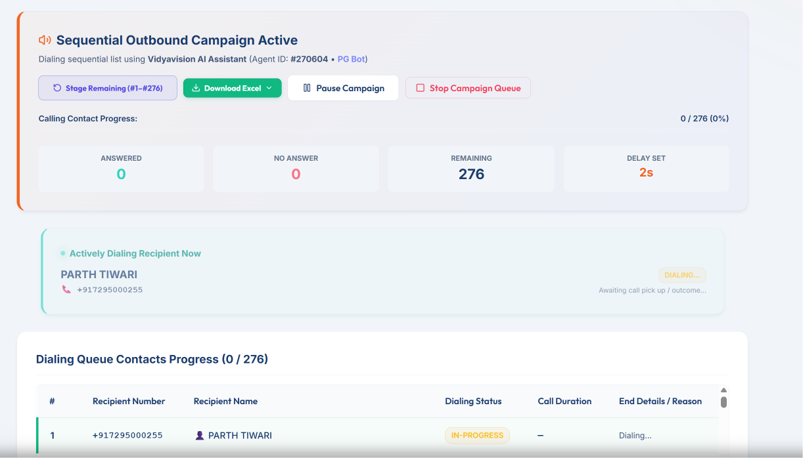
*Figure 16: Live Sequential Outbound Campaign Active Banner & Mid-Campaign Controls*

---

### Step 8: Managing Paused Campaigns in Call Dialer
- If a campaign was manually paused or auto-stopped by a cutoff limit:
  - Header displays an orange pill counter: `⏸️ N Paused`.
  - The **"Paused Campaigns Ready to Resume"** card displays right at the top of the Call Dialer tab.
  - Shows total uncalled leads waiting across all paused batches.
  - **Actions for Each Paused Campaign:**
    - **Resume Calling:** Starts dialing the remaining contacts immediately without re-uploading.
    - **Add / Append Contacts:** Loads the uncalled numbers into Staging so you can upload another Excel sheet or paste more numbers to append to the campaign before resuming!
    - **Excel:** Download the list of remaining uncalled contacts.
    - **Delete:** Safely removes the paused campaign.

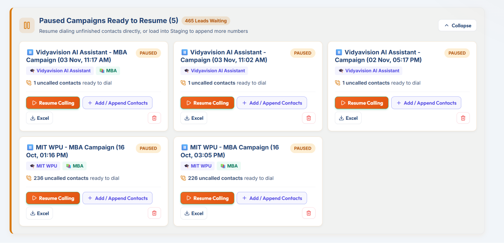
*Figure 17: Paused Campaigns Banner — Direct Resumption, Appending Leads, and Uncalled Export*

---

### Step 9: Completed Campaigns & Analytics in Dashboard
1. **Call Dashboard:**
   - Review high-level KPI cards: *Total Calls, Interested Students, Counselor Follow-up Required, Not Interested, Calls Not Answered*.
   - Filter by date range, specific university, or lead status.
   - Click the green **"Download Excel Report (.xlsx)"** button to export comprehensive student reports with durations, recordings, and lead ratings.
2. **Past Calling Campaigns Section:**
   - Expand the **Past Calling Campaigns** dropdown to view all historical campaign runs.
   - Inspect start timestamps, total recipients, and processed count.
   - Click any campaign name to inspect the full student recipient table.
   - Click **"Download Excel"** or **"Download CSV"** per campaign.
   - Rename campaigns with the edit pencil icon.


*Figure 18: Executive Call Dashboard — Lead Intelligence KPI Cards & Past Calling Campaigns Grid*

---

### Step 10: Recent Calls Intelligence, Audio Playback & WhatsApp
Navigate to **Recent Calls** to inspect individual student interactions:
- **Multi-Channel Audio Player:** Listen to the complete student-agent recording directly in the browser with seek and speed controls.
- **Turn-by-Turn Dialog Transcript:** Read the verbatim conversation with exact caller intent badges and AI admission assessments.
- **Counselor Follow-up Notes:** Save follow-up remarks and set scheduled callback dates.
- **1-Click WhatsApp Admission Brochure:** Click **"Send WhatsApp Info"** to automatically deliver official prospectus links directly to the student's phone.


*Figure 19: Call Detail Modal — Audio Playback Player, Verbatim Transcript, and Follow-Up Actions*

---

## 7. Spreadsheet Formatting & Lead Preparation Guide

To ensure flawless file uploads, follow these simple spreadsheet guidelines:

### Supported File Formats:
- Microsoft Excel (`.xlsx`, `.xls`)
- Comma-Separated Values (`.csv`)

### Recommended Column Headers:
The file parser is intelligent and recognizes standard variations of column headers:

| Field | Accepted Column Headers | Sample Value | Mandatory? |
| :--- | :--- | :--- | :---: |
| **Phone Number** | `Phone`, `Mobile`, `Contact`, `Phone Number`, `Student Phone` | `9876543210` or `+91 9876543210` | **YES** |
| **Student Name** | `Name`, `Student Name`, `Candidate Name`, `Full Name` | `Akash Sharma` | Optional |
| **Target Course** | `Course`, `Program`, `Stream`, `Branch` | `B.Tech CSE` | Optional |
| **City / State** | `City`, `District`, `State`, `Location` | `Vijayawada` | Optional |

### Best Practices:
1. **Indian Phone Numbers:** 10-digit mobile numbers starting with 6, 7, 8, or 9 are automatically formatted with the `+91` country code.
2. **Duplicate Detection:** If your sheet contains repeated telephone numbers, the system automatically imports the first entry and skips duplicates, alerting you in the summary pill.
3. **Formula Neutralization:** Do not include leading symbols like `=`, `+`, or `-` in student names to prevent spreadsheet calculation issues.

---

## 8. Troubleshooting & Frequently Asked Questions (FAQ)

### Q1: Why am I unable to download the Excel report?
> **Answer:** Your counselor account has **Data Leak Protection** enabled. Contact your VidyaVision Administrator to grant the **"Download Excel Sheet"** permission to your profile.

### Q2: Why did calling stop automatically at 6:30 PM?
> **Answer:** The platform is configured with **Telecom Compliance Window Protection** (09:30 AM – 06:30 PM IST). Calling halts automatically to comply with quiet-hours guidelines. All uncalled numbers are preserved in your queue and can be resumed the next morning.

### Q3: When I stage contacts, does another counselor see them?
> **Answer:** No. Each team member has an isolated, individual dialer workspace. Draft contacts staged by you remain strictly within your account.

### Q4: How does Call Transfer work if the counselor is busy?
> **Answer:** The AI attempts to connect the call to the configured counselor number. If the counselor's line is busy or unanswered, the AI politely informs the student that all counselors are currently assisting other callers and logs a **"Counselor Follow-up Required"** flag with the student's callback time.

### Q5: How do I send admission brochures via WhatsApp?
> **Answer:** Open any call in **Recent Calls** -> Click **Detail Report** -> Verify the student's mobile number and click **"Send WhatsApp Info"**. The official college brochure and application link will be dispatched immediately.

---

### Need Further Assistance?
For technical support, custom bot script modifications, or platform upgrades:
- **Internal Administrator:** Contact your designated VidyaVision Portal Admin.
- **Official Portal:** [www.vidyavision.com](https://www.vidyavision.com/)
- **Document Version:** `2.0-Enterprise (Nov 2026)`
