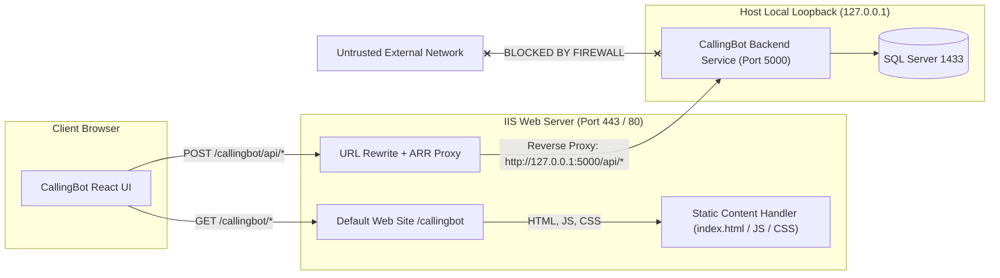

# CB-025: Configure Frontend-to-Backend Routing

## 1. Overview & Objectives
**Story Reference**: `CB-025` (EPIC-05: IIS Hosting, Routing & Integration Validation)  
**Goal**: Configure and validate robust routing between the frontend single-page application (hosted on IIS) and the private backend Node.js / SEA service. Keep the backend port (default `5000`) private and inaccessible from untrusted external networks.

---

## 2. Architecture & Reverse Proxy Topology



### Architectural Principles:
1. **Single Entry Point**: Clients access the application exclusively via standard HTTP/HTTPS ports (80/443). The backend port (`5000`) is never exposed directly to external networks.
2. **Reverse Proxy via IIS ARR**: IIS Application Request Routing (ARR) terminates external SSL, applies HSTS, and proxies `/api/*` requests internally to `http://127.0.0.1:5000/api/*`.
3. **Strict Rule Precedence**: In `web.config`, the Reverse Proxy rule executes **before** the `SPA Fallback` rule with `stopProcessing="true"`. This prevents API calls from ever returning `index.html`.
4. **Subpath Transparency**: The rewrite rule matches `^api(?:/(.*))?$`. Whether deployed as a root site (`/api/...`) or as a virtual application (`/callingbot/api/...`), the relative path is matched and forwarded seamlessly.

---

## 3. Configuration Details

### 3.1 IIS `web.config` Rewrite Rules
In [frontend/public/web.config](file:///c:/Users/Sravanth.claaps/VidyaVision-ai%20-ob/frontend/public/web.config):
```xml
<rewrite>
  <rules>
    <!-- 1. Optional HTTPS Redirection -->
    <rule name="Redirect to HTTPS" enabled="false" stopProcessing="true">
      <match url=".*" />
      <conditions logicalGrouping="MatchAll">
        <add input="{HTTPS}" pattern="off" ignoreCase="true" />
        <add input="{HTTP_HOST}" pattern="^localhost(:[0-9]+)?$" negate="true" />
        <add input="{HTTP_HOST}" pattern="^127\.0\.0\.1(:[0-9]+)?$" negate="true" />
      </conditions>
      <action type="Redirect" url="https://{HTTP_HOST}/{R:0}" redirectType="Permanent" />
    </rule>

    <!-- 2. Reverse Proxy /api/ requests to Backend Private Port (CB-025) -->
    <rule name="Reverse Proxy API to Backend" stopProcessing="true">
      <match url="^api(?:/(.*))?$" />
      <action type="Rewrite" url="http://127.0.0.1:5000/api/{R:1}" />
    </rule>

    <!-- 3. SPA Client-Side Routing Fallback (CB-023) -->
    <rule name="SPA Fallback" stopProcessing="true">
      <match url=".*" />
      <conditions logicalGrouping="MatchAll">
        <add input="{REQUEST_FILENAME}" matchType="IsFile" negate="true" />
        <add input="{REQUEST_FILENAME}" matchType="IsDirectory" negate="true" />
        <add input="{REQUEST_URI}" pattern="(^|/)api/" negate="true" />
      </conditions>
      <action type="Rewrite" url="index.html" />
    </rule>
  </rules>
</rewrite>
```

### 3.2 ARR Server Proxy Enablement
In IIS, rewriting to an HTTP URL requires ARR proxy to be enabled at the server level:
```powershell
Set-WebConfigurationProperty -pspath 'MACHINE/WEBROOT/APPHOST' -filter "system.webServer/proxy" -name "enabled" -value "True"
```
Or via `appcmd.exe`:
```cmd
%windir%\system32\inetsrv\appcmd.exe set config -section:system.webServer/proxy /enabled:"True" /commit:apphost
```

### 3.3 Windows Firewall Private Port Protection
Blocks public/external inbound access to port 5000, ensuring all external traffic enters via IIS:
```powershell
New-NetFirewallRule -DisplayName "CallingBot Backend Private Port Guard" `
                    -Direction Inbound `
                    -LocalPort 5000 `
                    -Protocol TCP `
                    -Action Block `
                    -Profile Public
```

---

## 4. Execution & Verification

### 4.1 Applying Routing Configuration
```powershell
npm run iis:routing
```
Or with custom backend port/host:
```powershell
powershell -ExecutionPolicy Bypass -File scripts/configure-iis-backend-routing.ps1 -BackendHost "127.0.0.1" -BackendPort 5000
```

### 4.2 Automated Compliance Verification
```powershell
npm run validate:routing
```
Expected output:
```text
========================================================
  CallingBot Frontend-to-Backend Routing Audit (CB-025)
========================================================

[1/3] Auditing web.config Reverse Proxy Rules...
  [PASS] Frontend Directory Exists - Path: C:\inetpub\CallingBot
  [PASS] Frontend web.config Exists & Valid - Path: C:\inetpub\CallingBot\web.config
  [PASS] Reverse Proxy Rule Present - Rule name: 'Reverse Proxy API to Backend'
  [PASS] API Route Match Pattern - Pattern matches: ^api(?:/(.*))?$
  [PASS] Target Private Port Binding - Rewrite Action: http://127.0.0.1:5000/api/{R:1}
  [PASS] Rule Precedence Ordering - Reverse Proxy rule (index 1) precedes SPA Fallback (index 2)
  [PASS] SPA Rule Excludes API Requests - Condition negates pattern: (^|/)api/

[2/3] Auditing ARR Proxy & Private Port Protection...
  [PASS] ARR Proxy Capability - ARR Reverse Proxy enabled or configured for IIS
  [PASS] Private Backend Port Isolation - Backend port (5000) blocked from public exposure

[3/3] Auditing End-to-End API Route Contract...
  [PASS] API Route Contract (Non-SPA Separation) - Rewrite contract verified: /api/* routes directly to backend and cannot return SPA index.html

========================================================
Audit Results: 10 Passed, 0 Failed
========================================================

[OK] CB-025 Frontend-to-Backend Routing verified successfully!
```
