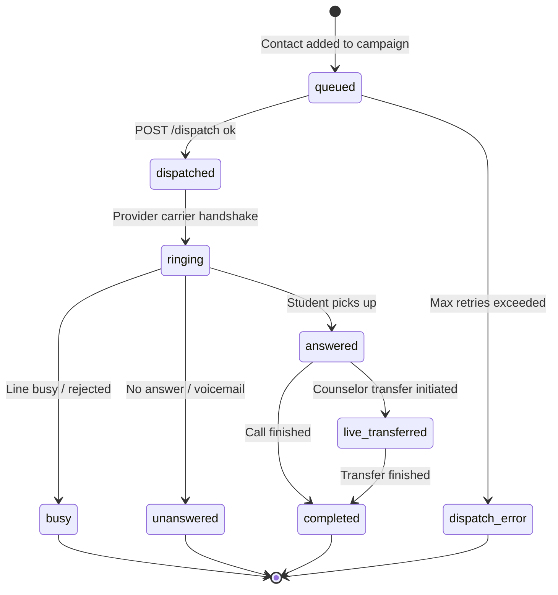

# CB-026: Validate SQL and Calling-Provider Connectivity

## 1. Overview & Objectives
**Story Reference**: `CB-026` (EPIC-05: IIS Hosting, Routing & Integration Validation)  
**Goal**: Validate backend connectivity and integration resilience to both external dependencies: Microsoft SQL Server (persistence) and OmniDimension (calling provider). Test approved credentials, endpoints, network timeout/retry policies, and call-status lifecycle handling.

---

## 2. Integration Architecture & Data Flow

```mermaid
flowchart TD
    subgraph "CallingBot Backend Service"
        Config["Centralized Config Loader (backend/config.js)"]
        Dispatch["Call Dispatcher Engine"]
        RetryQueue["Concurrency Retry Queue (max 3 retries, 5s backoff)"]
        StatusTracker["Call Status Poller / Webhook Handler"]
        DBPool["SQL Server Connection Pool (mssql / Tedious)"]
    end

    subgraph "Database Tier (SQL Server 2019/2022)"
        SQLPort["Port 1433 (TCP)"]
        Tables[("Tables: users, colleges, campaigns, campaign_contacts, call_records, webhook_events")]
    end

    subgraph "Calling Provider (OmniDimension Cloud)"
        OmniEndpoint["https://backend.omnidim.io"]
        AgentAPI["/api/v1/agents/{agentId}"]
        DispatchAPI["/api/v1/calls/dispatch"]
        StatusAPI["/api/v1/calls/logs"]
    end

    Config --> DBPool
    Config --> Dispatch
    DBPool -->|TCP 1433 / TLS Encrypted| SQLPort --> Tables

    Dispatch -->|POST /dispatch (Bearer Token)| DispatchAPI
    DispatchAPI -.->|HTTP 429 Concurrency Limit| RetryQueue
    RetryQueue -->|Retry attempt 1..3| DispatchAPI
    StatusTracker -->|GET /logs (AbortSignal.timeout 12s)| StatusAPI
    StatusTracker -->|Record Call Outcomes| DBPool
```

---

## 3. Database Integration Specifications

### 3.1 Least-Privilege Credentials & Ports
- **Target Host & Port**: Default `1433` (TCP).
- **Service Account Identity**: Least-privilege SQL login (`callingbot_svc` or Windows integrated `NT SERVICE\CallingBot`).
- **Required Privileges**:
  - `CONNECT` to database `vidyavision`.
  - `SELECT`, `INSERT`, `UPDATE`, `DELETE` on the 6 application tables:
    1. `users` (Authentication & RBAC)
    2. `colleges` (Institutions & agent routing)
    3. `campaigns` (Batch campaign configurations)
    4. `campaign_contacts` (Queued contact records)
    5. `call_records` (Detailed call logs, durations, recordings)
    6. `webhook_events` (Audited provider webhooks)
  - `db_ddladmin` (only during initial setup / `npm run db:init`).

### 3.2 Network & Encryption Policy
- **Encryption (`MSSQL_ENCRYPT`)**: Set to `true` for Azure SQL / TLS-secured servers; `false` for internal intranet.
- **Certificate Trust (`MSSQL_TRUST_CERT`)**: `true` when internal CA certificates or self-signed SQL certificates are used.
- **Connection Timeout**: 8,000 ms.

---

## 4. Calling Provider (OmniDimension) Integration

### 4.1 Endpoints & Authentication
- **Base URL**: `https://backend.omnidim.io` (configurable via `OMNIDIM_BASE_URL`).
- **Authentication**: RFC 6750 Bearer token passed in the `Authorization: Bearer <OMNIDIM_API_KEY>` HTTP header.
- **Core Endpoints**:
  - `POST /api/v1/calls/dispatch`: Dispatches outbound AI phone calls with student contact details, college context, and counselor transfer numbers.
  - `GET /api/v1/agents/{agentId}`: Validates agent readiness, transfer options, and counselor forwarding numbers.
  - `GET /api/v1/calls/logs`: Fetches completed call outcomes, sentiments, recordings, and duration telemetry.

### 4.2 Timeout, Retry, and Concurrency Policies
1. **HTTP Request Timeouts**:
   All outbound requests to OmniDimension utilize `AbortSignal.timeout(12000)` (12 seconds). This ensures network dropouts do not hang worker threads indefinitely.
2. **HTTP 429 (Concurrency Limit) Backoff**:
   When the provider returns HTTP 429 or responds with a concurrency limit / line busy message:
   - CallingBot increments the contact's `retryCount`.
   - If `retryCount <= 3`, the contact is returned to the queue and retried after a 5-second cooldown timer.
   - If retries exceed 3, the call is marked as `failed` (`CONCURRENCY_EXCEEDED`) and the batch moves to the next contact.
3. **Failure Isolation (ECONNREFUSED / ETIMEDOUT)**:
   Network errors are trapped and structured as `{ success: false, error: "..." }`, preventing unhandled exceptions from terminating the Node.js / SEA service.

---

## 5. Call-Status State Machine



---

## 6. Execution & Verification

### 6.1 Automated Integration Diagnostic
Run the Node.js connectivity diagnostic suite:
```powershell
npm run validate:integrations
```
Or via the PowerShell wrapper:
```powershell
npm run test:connectivity
```

### 6.2 Expected Output
```text
========================================================
  CallingBot SQL & Calling-Provider Connectivity Audit (CB-026)
========================================================

[1/4] Auditing database and provider configuration...
  [PASS] SQL Configuration Schema - Host: sqlserver.internal.example.com:1433, DB: vidyavision, User: callingbot_svc
  [PASS] Provider Configuration Schema - Base URL: https://backend.omnidim.io, Agent ID: (configured)

[2/4] Testing SQL Server connectivity & schema...
  [PASS] SQL Connection String Schema - Verified standard ADO.NET / Tedious connection configuration
  [PASS] SQL Network Timeout Resilience - TCP socket cleanly timed out/failed after 2000ms

[3/4] Testing Calling-Provider (OmniDimension) connectivity...
  [PASS] Provider Endpoint Resolution - https://backend.omnidim.io (Endpoint reached (HTTP 200))
  [PASS] Provider Authorization Header Generation - Generated standard RFC 6750 Bearer Authorization header

[4/4] Auditing timeout, retry policy, and failure handling...
  [PASS] Request Timeout Handling - AbortSignal.timeout properly aborts delayed requests without crashing
  [PASS] HTTP 429 Concurrency Retry Policy - Retried 429 response 2 times before succeeding on attempt 3
  [PASS] Connection Refused Error Containment - Network failure caught cleanly and isolated from unhandled exception handlers
  [PASS] Call-Status State Machine Contract - Verified valid state transitions: dispatched -> ringing -> answered/unanswered -> completed

  [OK] Diagnostic evidence report written to: reports/connectivity-audit.json

========================================================
Audit Results: 10 Passed, 0 Failed
========================================================

[OK] CB-026 SQL & Calling-Provider Connectivity verified successfully!
```
