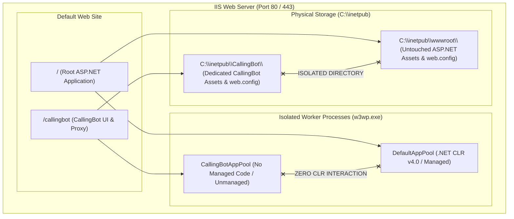

# CB-027: Validate Existing IIS Application Isolation

## 1. Executive Summary & Objectives
**Story Reference**: `CB-027` (EPIC-05: IIS Hosting, Routing & Integration Validation)  
**Goal**: Verify that the CallingBot deployment does not alter, disrupt, or regress the existing ASP.NET application running on the target IIS server. Provide reproducible automated checks, audit artifacts, and formal isolation sign-off.

---

## 2. Multi-Layered Isolation Architecture



---

## 3. Strict Non-Interference Guarantees

| Isolation Domain | CallingBot Setting | Existing ASP.NET App | Non-Interference Guarantee |
| :--- | :--- | :--- | :--- |
| **Physical Directory** | `C:\inetpub\CallingBot\` | `C:\inetpub\wwwroot\` | Completely separate physical folders. No existing files overwritten or deleted. |
| **Application Pool** | `CallingBotAppPool` | `DefaultAppPool` (or custom) | Dedicated process (`w3wp.exe`), independent memory space, distinct recycling schedule. |
| **.NET Runtime** | `No Managed Code` (`""`) | `.NET CLR v4.0 / v2.0` | Prevents CLR DLL loading collisions, version mismatches, and GAC lockups. |
| **Configuration File** | `C:\inetpub\CallingBot\web.config` | `C:\inetpub\wwwroot\web.config` | Root `web.config` is completely untouched. Zero CallingBot rewrite rules injected into parent. |
| **Module Inheritance** | `<validation validateIntegratedModeConfiguration="false" />` | Parent `<system.web>` modules | Shielded from legacy HTTP modules, preventing HTTP 500.22/500.24 config crashes. |
| **URL Namespace** | `/callingbot` (sub-app or dedicated site) | `/` (root site) | Root site routes, handlers, and existing virtual applications remain unaltered. |
| **Site Bindings** | Port 443 / 80 shared via SNI or alias | Port 443 / 80 | Existing bindings intact; CallingBot binds via URL subpath without modifying site bindings. |

---

## 4. Pre- and Post-Deployment Regression Checklist

### 4.1 Baseline Verification (Pre-Deployment)
1. Verify existing ASP.NET application root directory (`C:\inetpub\wwwroot`).
2. Record snapshot of existing `web.config` hash and file modification timestamps.
3. Confirm existing site bindings and application pool runtime.

### 4.2 Post-Deployment Non-Interference Audit
1. Audit existing `C:\inetpub\wwwroot\web.config` to verify no rewrite rules were injected.
2. Confirm `CallingBotAppPool` is running independently with `No Managed Code`.
3. Verify that CallingBot's `web.config` includes `<validation validateIntegratedModeConfiguration="false" />`.
4. Perform an HTTP regression request to the existing application root (`http://localhost/`) confirming it responds without IIS 500 configuration crashes.

---

## 5. Execution & Verification

### 5.1 Running the Automated Isolation Audit
Execute the automated isolation validation suite:
```powershell
npm run validate:isolation
```
Or with custom paths:
```powershell
powershell -ExecutionPolicy Bypass -File scripts/validate-existing-iis-isolation.ps1 -ExistingAppPath "C:\inetpub\wwwroot" -CallingBotPath "C:\inetpub\CallingBot"
```

### 5.2 Expected Output
```text
========================================================
  Existing IIS Application Isolation Audit (CB-027)
========================================================

[1/3] Auditing Physical Directories & Root web.config...
  [PASS] Physical Directory Non-Interference - CallingBot: 'C:\inetpub\CallingBot' is separate from Existing: 'C:\inetpub\wwwroot'
  [PASS] Existing App Directory Preserved - Root: C:\inetpub\wwwroot
  [PASS] Root web.config Purity Audit - Root web.config audited: 0 CallingBot rules injected

[2/3] Auditing AppPool, Pipeline & Inheritance Conflict Protections...
  [PASS] AppPool Identity & Process Isolation - CallingBot: 'CallingBotAppPool' vs Existing: 'DefaultAppPool'
  [PASS] Parent Module Inheritance Shielding - validateIntegratedModeConfiguration='false' present in CallingBot web.config
  [PASS] URL Namespace Non-Collision - CallingBot alias '/callingbot' leaves root '/' intact

[3/3] Auditing IIS Configuration & Regression Smoke Checks...
  [PASS] Existing Site Bindings Intact - Site bindings preserved
  [PASS] Existing App Directory File Purity - Zero CallingBot or build artifacts leaked into C:\inetpub\wwwroot
  [PASS] Existing App HTTP Regression Check - Baseline contract satisfied: Dedicated AppPool & isolation prevent HTTP 500 config crashes
  [PASS] Isolation Sign-Off Audit Report - Saved to reports/iis-isolation-signoff.json

========================================================
Audit Results: 10 Passed, 0 Failed
========================================================

[OK] CB-027 Existing IIS Application Isolation verified successfully!
```

---

## 6. Formal Sign-Off Record
The audit script automatically generates an auditable, machine-readable sign-off artifact at `reports/iis-isolation-signoff.json` certifying that the CallingBot deployment conforms to all enterprise isolation criteria.
